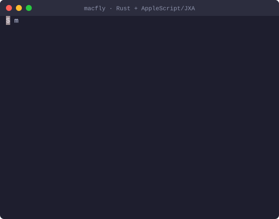

# macfly

**Let AI work with your Mac. On your terms.**

MacFly is a **Controlled AI Access Layer** for macOS in pure Rust — giving AI agents (Claude, Codex, Cursor, or local LLMs via Ollama/MLX) policy-guarded access to Apple Notes, Mail, Contacts, Calendar, Reminders, Safari, and Shortcuts, with local secret redaction and human-approved change plans.

> *Your AI knows what to do. MacFly controls what it can do.*

**macOS only** — MacFly runs on Macs (Apple Silicon or Intel) and drives the Apple apps through macOS Automation. There is no Windows, Linux or iOS version.

**Website:** [casoon.github.io/macfly](https://casoon.github.io/macfly/) · [Use Cases & Prompts](https://casoon.github.io/macfly/demo/) · [Changelog](https://casoon.github.io/macfly/changelog/)



## What it does

- **Apple Notes** — hierarchical folder overview, cleanup audit (empty folders, single-note folders, duplicate titles, oldest notes), search, cleaned reading with a **fidelity guard** (protects attachments, tables, checklists, and `applenotes://` links), lossless folder/note moves, **Markdown export**, and **multi-format import** (`.md`, `.txt`, `.html`, `.json`, `.jsonl`, `.csv` with `--recursive`)
- **Apple Mail** — account and mailbox overview, direct signature lookup from Apple Mail (single source of truth), search, quote-trimmed reading with `untrusted_external` framing, safe draft creation (never sends unattended), and **Markdown email archiving (`mail export`)**
- **Apple Contacts** — fast batched contact search, duplicate & empty-contact audit (`contacts audit`), and **Markdown contact card export (`contacts export`)**
- **Apple Calendar & Reminders** — upcoming events, open/overdue reminders, unified 4-app `daily-brief` context pack, **Calendar/Reminders Markdown export**, and **multi-format Reminders import** (`.md`, `.txt`, `.json`, `.jsonl`, `.csv`)
- **Apple Safari** — inspect open browser tabs (`safari tabs`), export tabs to Markdown (`safari export`), or migrate open research tabs directly into an Apple Note via plan (`safari to-note`)
- **Apple Photos** — list albums and photos with metadata (`photos albums`, `photos list`), and export through a reviewed plan (`photos export`): original files or rendered JPEGs, optional XMP/JSON metadata files next to each photo, optional conversion with the built-in `sips` (HEIC → JPEG/PNG/TIFF, smaller size, quality); never overwrites, writes a SHA-256 manifest
- **Apple Shortcuts** — allowlist-gated bridge to `shortcuts list` and `shortcuts run` (Focus modes, HomeKit scenes, modern App Intents)
- **Cross-app Context Packs & Typst/PDF Dossiers** — `context daily-brief`, `context person "<Name/Email>"` (360° dossier across 5 apps), `context meeting-prep [--create-note]`, `context weekly-review`, plus `macfly report` for Typst (`.typ` / `renderreport`), Markdown (`.md`), or PDF (`.pdf`) dossiers
- **Agent Skill Exporter & `launchd` Scheduler** — `macfly skill export` generates a ready-to-use `SKILL.md` for Claude Code, Codex, Cursor, or Antigravity; `macfly schedule` manages native macOS `LaunchAgents` without a custom background daemon
- **Read-side Data Firewall (DLP)** — profile-based allowlists/denylists (`deny_folders`, `deny_mailboxes`) plus automatic linear-time regex redaction of private keys, API keys, IBANs, Luhn-valid card numbers, 6-digit OTP codes, and passwords after keywords like `Passwort:` before output reaches any LLM
- **Security presets** — pick `strict`, `balanced` (default) or `open` once instead of writing rules: `balanced` lets low-risk creates (notes, folders, mail drafts, reminders) run automatically and asks you for moves, appends, deletes and Shortcuts; `macfly policy` explains the active rules in plain language
- **Transactional change plans & `runemark` terminal UI** — every write goes through `plan create → inspect → approve → apply` with canonical SHA-256 plan hashing, tamper detection, expiry TTL, interactive approval for everything the preset doesn't cover, a local JSONL audit journal, and semantic terminal reports powered by [`runemark`](https://casoon.github.io/runemark/)
- **Built-in `stdio` MCP server** — exposes 22 read, context-pack & plan tools (`plan_create`, `plan_inspect`, `plan_apply` for already-approved plans); `plan_approve` is intentionally excluded from MCP so agents can propose changes but never approve them

## Why Rust + AppleScript/JXA

- **Deterministic core:** Policy evaluation, DLP redaction, HTML/email normalization, multi-format import parsers, fidelity checks, plan hashing, and audit journaling live in pure, memory-safe Rust and run offline in milliseconds via `cargo test`.
- **Zero SDK / Xcode drift:** No Swift toolchain, no Xcode project, no Node.js runtime, and no fragile private SQLite assumptions in the default path.
- **Safe, batched JXA edge:** All scripts are statically embedded (`include_str!`), receive parameters strictly as JSON over `stdin` (no `argv` leakage in `ps aux`), use batched property fetches, and enforce hard timeouts with typed TCC error hints.

## Requirements

- **macOS** (Apple Silicon or Intel)
- macOS Automation (TCC) permission for the apps you use (prompted automatically on first run; verified via `macfly doctor`)
- *(Optional, only if building from source)* Rust toolchain (`cargo`, Edition 2024)

## Installation & quick start

```sh
# Direct macOS binary installer (no Rust/Cargo required, SHA-256 verified):
curl -fsSL https://raw.githubusercontent.com/casoon/macfly/main/install.sh | bash

# Or install via Cargo:
cargo install macfly

macfly doctor
macfly config init   # asks for the security preset (strict / balanced / open)
```

Official binaries come only from the GitHub releases of `casoon/macfly` — built
there by the release workflow, never on a developer machine. To verify a
download by hand, check the hash and the signed build provenance:

```sh
shasum -a 256 -c SHA256SUMS --ignore-missing
gh attestation verify macfly-aarch64-apple-darwin.tar.gz --repo casoon/macfly
```

Everyday commands (all support `--format pretty`, `--format json`, and `--format agent`, plus `--color auto|always|never`):

```sh
# Apple Notes (inspect, audit, export & multi-format import)
macfly notes overview
macfly notes audit
macfly notes list --limit 20
macfly notes search "Roadmap"
macfly notes read "<note-id>"
macfly notes export --output ./notes-backup --folder "10 · Work"
macfly notes import --input ./evernote-or-notion --folder "00 · Inbox" --recursive

# Apple Mail (inspect, signatures, read & Markdown export)
macfly mail overview
macfly mail signatures
macfly mail list --unread --limit 15
macfly mail read "<local-id>"
macfly mail export --output ./mail-archive --query "Invoice" --limit 20

# Apple Contacts (search, audit & Markdown export)
macfly contacts list --limit 50
macfly contacts search "Acme"
macfly contacts audit
macfly contacts export --output ./contacts-backup

# Apple Calendar & Reminders (events, tasks, export & multi-format import)
macfly calendar events --days 7
macfly calendar export --output ./upcoming-events.md --days 14
macfly reminders list --overdue
macfly reminders export --output ./open-tasks.md
macfly reminders import --input ./tasks.csv --list "Work"

# Apple Safari & Apple Shortcuts
macfly safari tabs
macfly safari export --output ./research-tabs.md
macfly safari to-note --folder "00 · Inbox" --title "Research Links"
macfly shortcuts list

# Multi-app context packs & Typst / PDF dossiers
macfly context daily-brief --format agent
macfly context person "Acme"
macfly context meeting-prep --query "Kickoff" --create-note --folder "00 · Inbox"
macfly context weekly-review
macfly report person "Acme" --output ./dossier-acme.typ

# Agent SKILL.md export & macOS launchd routines
macfly skill export --output ./.claude/skills/macfly
macfly schedule install --name morning-brief --task daily-brief --hour 7 --minute 30 --dry-run
```

## Configuration

MacFly uses a single configuration file at `~/.config/macfly/config.json` (override with `--config` or `$MACFLY_CONFIG`). Email accounts stay in Apple Mail, and signatures default to `{"source": "apple-mail"}` so your email footer has a single source of truth.

See [Getting Started](https://casoon.github.io/macfly/docs/guide/getting-started/) and [Migrations & Backups](https://casoon.github.io/macfly/docs/guide/migrations/) for the full configuration schema and migration workflows.

## Plans & audit journal

```sh
macfly policy                         # what the active preset allows
macfly plan create --input plan.json  # auto-approved or pending, depending on the preset
macfly plan inspect <plan-id>
macfly plan approve <plan-id>         # only for pending plans: interactive terminal, approves and applies
macfly history
```

Set the preset per profile in `config.json` (`"preset": "strict" | "balanced" | "open"`); `macfly config init` asks once. With shell-capable agents (Claude Code, Codex), presets are guardrails, not a sandbox — see the [Security Model](https://casoon.github.io/macfly/docs/architecture/security-model/#honest-system-boundary).

Plans are stored at `~/.local/share/macfly/plans/` (`0600`) and executions are logged to `~/.local/share/macfly/journal.jsonl` (`0600`). See [Plans & Workflows](https://casoon.github.io/macfly/docs/guide/plans-and-workflows/) for all supported operations.

## MCP server

Point any MCP-compatible client (Claude Desktop, Cursor, Antigravity, or local LLM runners) to the same binary:

```json
{
  "mcpServers": {
    "macfly": {
      "command": "macfly",
      "args": ["mcp", "--profile", "default"]
    }
  }
}
```

See [MCP & AI Agents](https://casoon.github.io/macfly/docs/guide/mcp-and-agents/) and [Security Model](https://casoon.github.io/macfly/docs/architecture/security-model/) for details.

## Author

Built and maintained by [Jörn Seidel](https://www.casoon.de/joern-seidel/) ([CASOON](https://www.casoon.de/)). Background and design decisions are described in an article on Insights (in German): [MacFly: Kontrollierter KI-Zugriff auf Notizen, Mail und Kalender](https://insights.casoon.de/artikel/macfly-macos-automatisierung-ki-agenten-freigabe/).

## License

Dual-licensed under **MIT** or **Apache-2.0**, at your option.
